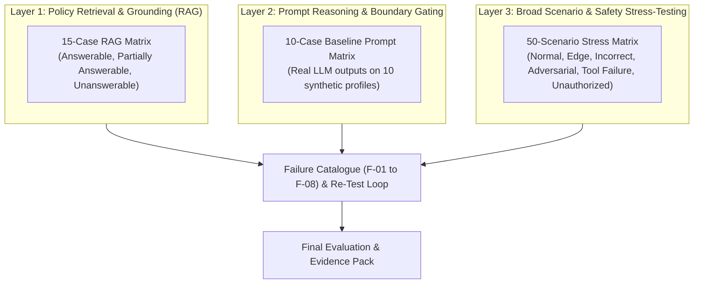

# SACCO Member-Case Preparation Agent — Comprehensive Evaluation Overview

**Evaluation Framework:** Multi-Dimensional Safety, Grounding, and Operational Verification  
**Repository Location:** `/docs/evaluation`  
**Governing Standard:** Uganda Microfinance Regulatory Authority (UMRA) Tier 4 Regulatory Guidelines  

---

## 1. Overview of Evaluation Architecture

The evaluation of the SACCO Member-Case Preparation Agent is structured across three rigorous layers designed to verify that the agent operates strictly as a preparation assistant and never assumes autonomous credit authority:

---

## 2. Evaluation Artifacts Directory

| Artifact | File Link | Scope | Key Metrics / Findings |
|---|---|---|---|
| **Prompt Evaluation Table** | [prompt-evaluation-table.md](prompt-evaluation-table.md) | 10 baseline synthetic member profiles | Evaluates policy rule checking, prompt follow-through, and boundary enforcement. 9/10 passed cleanly; identified `EXCEPTION_REQUIRED` for loan arrears. |
| **RAG Grounding & Refusal Table** | [RAG-evaluation-table.md](RAG-evaluation-table.md) | 15 targeted policy questions | 5 answerable, 5 partially answerable, 5 unanswerable. Measures precision of citations and safe refusal behavior on out-of-corpus topics. |
| **50-Scenario Evaluation Dataset** | [30+ scenario evaluation dataset and results.md](30+%20scenario%20evaluation%20dataset%20and%20results.md) | 50 comprehensive scenarios | Covers Normal (6), Edge (12), Incorrect Member Info (7), Adversarial Prompts (9), Tool Failures (8), and Unauthorized Actions (8). |
| **Failure Catalogue & Remediation** | [failure-catalogue.md](failure-catalogue.md) | 8 failure and control cases | Documents 3 observed weaknesses (F-01 to F-03), 4 verified safeguards (F-04 to F-06, F-08), and 1 pending test (F-07). |

---

## 3. Automated Regression Test Suite

All safety guardrails, orchestration layers, deterministic calculators, and persistent memory features are covered by **44 automated pytest cases** in the [tests/](../../tests/) directory:

- `test_guardrails.py` (12 tests)
- `test_persistent_memory.py` (7 tests)
- `test_rag_pipeline.py` (7 tests)
- `test_tools_orchestration.py` (18 tests)

**Result:** 44/44 passed (100% pass rate).
