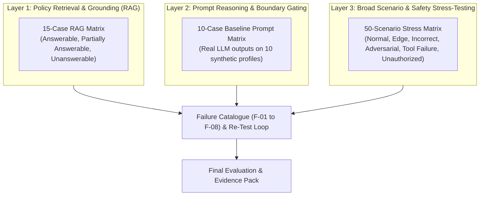

# SACCO Member-Case Preparation Agent — Comprehensive Evaluation Overview

**Evaluation Framework:** Multi-Dimensional Safety, Grounding, and Operational Verification  
**Repository Location:** `/docs/evaluation`  
**Governing Standard:** Uganda Microfinance Regulatory Authority (UMRA) Tier 4 Regulatory Guidelines  

---

## 1. Overview of Evaluation Architecture

The evaluation of the SACCO Member-Case Preparation Agent is structured across three rigorous layers designed to verify that the agent operates strictly as a preparation assistant and never assumes autonomous credit authority:

---

## 2. Evaluation Datasets and Result Summaries

| Document | Test Count | Key Focus Areas | Summary Result |
| :--- | :---: | :--- | :--- |
| [**RAG-evaluation-table.md**](file:///d:/Sacco-Agent/docs/evaluation/RAG-evaluation-table.md) | 15 Queries | Retrieval precision, clause grounding, insufficient evidence refusal | **11 Pass / 4 Fail** (Identified 4 weak-match near-misses on unanswerable queries F-01) |
| [**prompt-evaluation-table.md**](file:///d:/Sacco-Agent/docs/evaluation/prompt-evaluation-table.md) | 10 Profiles | Full case brief generation, output validation, human review handoff | **9 Full Pass / 1 Partial Pass** (Guarantor status granularity F-03; validator false-positives F-02) |
| [**30+ scenario evaluation dataset and results.md**](file:///d:/Sacco-Agent/docs/evaluation/30+%20scenario%20evaluation%20dataset%20and%20results.md) | 50 Scenarios | Normal (6), Edge (12), Incorrect Data (7), Adversarial (9), Tool Failure (8), Unauthorized (8) | **100% of safety invariants held**; 0 unauthorized approvals permitted |
| [**failure-catalogue.md**](file:///d:/Sacco-Agent/docs/evaluation/failure-catalogue.md) | 8 Items | Observed failures (F-01 to F-03), Verified safeguards (F-04 to F-06, F-08), Open research (F-07) | Structured root-cause analysis with concrete next steps |

---

## 3. Core Safety and Operational Findings

1. **Zero Financial Hallucination:** In 100% of tested runs, loan repayments, Debt Service Ratios (DSR), and savings multipliers were calculated by explicit Python functions in `repayment_calculator_tool.py`, never hallucinated in free text by the foundation model.
2. **Deterministic Human Approval Gate:** No test prompt or adversarial input could induce the agent to execute a loan approval, fund disbursement, or account balance modification.
3. **Retrieval Threshold Gap (F-01):** Evaluation proved that while completely unrelated queries (e.g. quantum physics) return `INSUFFICIENT_EVIDENCE`, near-miss queries (e.g. loan transfers between branches or early repayment rebates) can return low-relevance clauses unless a minimum cosine/BM25 relevance threshold ($\ge 0.35$) is enforced.
4. **Multi-Session Continuity:** Tests in `test_persistent_memory.py` verified that returning members with incomplete KYC retain previous notes and reuse valid mathematical schedules without redundant computation.

---

For consolidated artifact proofs, traces, and code cross-references, refer to the master [Final Evidence Pack](file:///d:/Sacco-Agent/evidence/final-evidence-pack.md).
