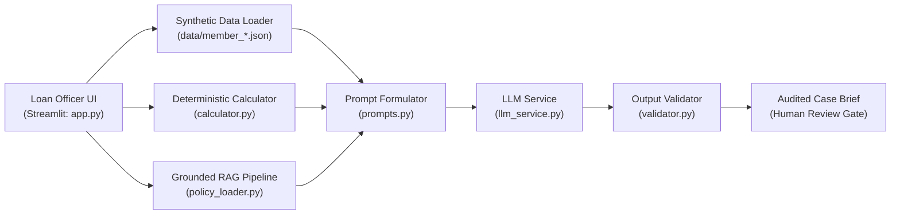

# SACCO Agent Interactive Demonstration Guide and Outputs

**Evidence Module:** Working Interactive Prototype, Baseline Demonstration Scenarios, and Verification Scripts  
**Repository Location:** `/evidence/demo`  
**Application Source Directory:** [`evidence/demo/sacco_baseline/`](file:///d:/Sacco-Agent/evidence/demo/sacco_baseline)  
**Primary UI Script:** [`app.py`](file:///d:/Sacco-Agent/evidence/demo/sacco_baseline/app.py)  

---

## 1. Prototype Overview and Architectural Components

The interactive demonstration prototype allows credit officers, auditors, and evaluators to interact with the SACCO Member-Case Preparation Agent through a Streamlit web interface. It combines live deterministic Python computation with retrieved policy evidence and foundation-model case brief synthesis.



### Module Responsibilities:
* [`app.py`](file:///d:/Sacco-Agent/evidence/demo/sacco_baseline/app.py): Streamlit dashboard with parameter sliders, synthetic member selector, schedule viewer, and case brief viewer.
* [`calculator.py`](file:///d:/Sacco-Agent/evidence/demo/sacco_baseline/calculator.py): Deterministic implementation of equal monthly amortization (reducing balance), total interest, and Debt Service Ratio.
* [`policy_loader.py`](file:///d:/Sacco-Agent/evidence/demo/sacco_baseline/policy_loader.py): Ingestion and semantic retrieval across the 20 approved SACCO policy documents.
* [`prompts.py`](file:///d:/Sacco-Agent/evidence/demo/sacco_baseline/prompts.py): Bounded context assembler instructing the model to act strictly as a case preparer without approval powers.
* [`validator.py`](file:///d:/Sacco-Agent/evidence/demo/sacco_baseline/validator.py): Post-generation safety filter scanning for unauthorized approval phrasing.

---

## 2. Setup and Execution Instructions

### Prerequisites
* Python 3.10 or 3.11
* Dependencies specified in [`requirements.txt`](file:///d:/Sacco-Agent/evidence/demo/sacco_baseline/requirements.txt):
  `streamlit`, `google-genai`, `openai`, `python-dotenv`

### Starting the Interactive Demo
Open a terminal in the repository root and run:
```powershell
# Navigate to the demo directory
cd evidence\demo\sacco_baseline

# Activate virtual environment
.\venv\Scripts\Activate.ps1

# Launch the Streamlit application
streamlit run app.py
```
The interface opens at `http://localhost:8501`.

---

## 3. Four Core Demonstration Scenarios

### Scenario 1: Standard Eligible Case (`member_001.json`)
* **Applicant:** John Okello (M-001) | UGX 6,000,000 | 12 Months | 18% p.a.
* **Demonstrated Behavior:**
  * Deterministic calculator produces exact monthly installment of **UGX 550,080.00**.
  * DSR computed as **53.34%** (flagged as slightly exceeding 50% threshold for loan officer attention).
  * System checks membership tenure (30 months $\ge$ 6m: **PASS**), shares (**PASS**), and KYC (**PASS**).
  * Draft case brief is assembled with mandatory human-in-the-loop notice: *"For Loan Officer review only. Not an approval."*

### Scenario 2: Missing KYC Incomplete Stop (`member_002_missing_kyc.json`)
* **Applicant:** Mary Mbabazi (M-002) | UGX 4,000,000 | 12 Months
* **Demonstrated Behavior:**
  * KYC status in record is `missing`.
  * Agent marks KYC as **`PENDING_EVIDENCE`** and refuses to forward the case to committee.
  * Preserves calculated illustrative schedule so the officer can counsel the member while requesting National ID / LC1 documents.

### Scenario 3: Non-Compliant Term Length (`member_003_invalid_term.json`)
* **Applicant:** Patrick Kato (M-003) | UGX 8,000,000 | 36 Months requested
* **Demonstrated Behavior:**
  * Policy `SACCO-CREDIT-001 §4` caps development loan terms at 24 months.
  * System flags **Repayment Term: FAIL (36 months exceeds 24-month cap)**.
  * Explains the conflict in plain text and routes to human staff to either restructure the term or request a formal Board waiver.

### Scenario 4: Delinquent Borrower Arrears Gating (`member_004_arrears.json`)
* **Applicant:** Agnes Nakato (M-004) | UGX 3,000,000 | Active arrears = `true`
* **Demonstrated Behavior:**
  * System detects active delinquency flag.
  * Rule check triggers **`EXCEPTION_REQUIRED`** pursuant to `SACCO-RISK-001 §4.1`.
  * The agent refuses to certify eligibility, halting the progression until prior arrears are regularized.

---

## 4. Summary of Demonstrated Controls

1. **Clear UI Warning:** Prominently warns users on every screen that the system uses synthetic data and cannot approve credit.
2. **Deterministic Computation:** No arithmetic is performed by the LLM; all installment schedules, interest sums, and ratios originate from Python math functions.
3. **Structured Handoff:** Every case brief concludes with specific checkboxes for Loan Officer sign-off and Credit Committee review.
