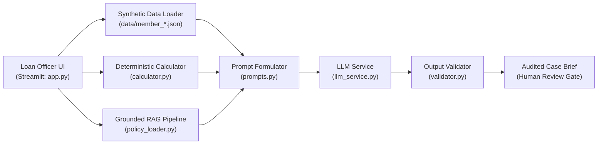

# SACCO Agent Interactive Demonstration Guide and Outputs

**Evidence Module:** Working Interactive Prototype, Baseline Demonstration Scenarios, and Verification Scripts  
**Repository Location:** `/evidence/demo`  
**Application Source Directory:** [`evidence/demo/sacco_baseline/`](file:///c:/Users/USER/OneDrive/Desktop/SACCO%20PROJECT/SACCO-Member-Case-Preparation-Agent/evidence/demo/sacco_baseline)  
**Primary UI Script:** [`app.py`](file:///c:/Users/USER/OneDrive/Desktop/SACCO%20PROJECT/SACCO-Member-Case-Preparation-Agent/evidence/demo/sacco_baseline/app.py)  

---

## 1. Live Cloud Deployment

The baseline system is deployed and publicly accessible online:

- **Streamlit Cloud URL:**  
  [https://sacco-member-case-preparation-agent-bzbryaduwvsuifpyzbu5fx.streamlit.app/](https://sacco-member-case-preparation-agent-bzbryaduwvsuifpyzbu5fx.streamlit.app/)

The interactive demonstration prototype allows credit officers, auditors, and evaluators to interact with the SACCO Member-Case Preparation Agent through a Streamlit web interface. It combines live deterministic Python computation with retrieved policy evidence and foundation-model case brief synthesis.

---

## 2. Prototype Architecture & Workflow



### Module Responsibilities:
* [`app.py`](file:///c:/Users/USER/OneDrive/Desktop/SACCO%20PROJECT/SACCO-Member-Case-Preparation-Agent/evidence/demo/sacco_baseline/app.py): Streamlit dashboard with parameter sliders, synthetic member selector, schedule viewer, and case brief viewer.
* [`calculator.py`](file:///c:/Users/USER/OneDrive/Desktop/SACCO%20PROJECT/SACCO-Member-Case-Preparation-Agent/evidence/demo/sacco_baseline/calculator.py): Deterministic implementation of equal monthly amortization (reducing balance), total interest, and Debt Service Ratio.
* [`policy_loader.py`](file:///c:/Users/USER/OneDrive/Desktop/SACCO%20PROJECT/SACCO-Member-Case-Preparation-Agent/evidence/demo/sacco_baseline/policy_loader.py): Ingestion and semantic retrieval across the 20 approved SACCO policy documents.
* [`prompts.py`](file:///c:/Users/USER/OneDrive/Desktop/SACCO%20PROJECT/SACCO-Member-Case-Preparation-Agent/evidence/demo/sacco_baseline/prompts.py): Bounded context assembler instructing the model to act strictly as a case preparer without approval powers.
* [`validator.py`](file:///c:/Users/USER/OneDrive/Desktop/SACCO%20PROJECT/SACCO-Member-Case-Preparation-Agent/evidence/demo/sacco_baseline/validator.py): Post-generation safety filter scanning for unauthorized approval phrasing.

---

## 3. Running the Demo Locally

### Interactive Streamlit UI
*Requires a valid `GEMINI_API_KEY` set in your `.env` file.*

```bash
streamlit run evidence/demo/sacco_baseline/app.py
```
Access the application at `http://localhost:8501`.

### Standalone CLI Scenarios Demo
*Does not require any API key or external service.*

```bash
cd src/agent
python run_demo.py
```
This script exercises 3 core workflows and outputs structured traces to `src/agent/execution_traces.txt`.

### Multi-Session Persistent Memory Demo
*Does not require any API key.*

```bash
cd src/agent
python run_demo_memory.py
```
Demonstrates safe multi-session state resumption and Credit Committee finality locking.
