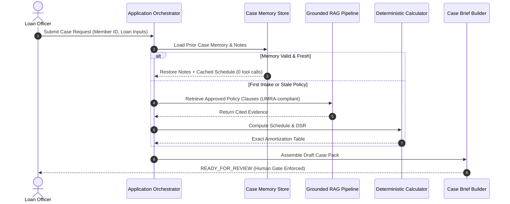

# SACCO Agent Execution Traces and Observability Evidence

**Evidence Module:** Workflow Execution Traces, Multi-Session Memory Logs, and Structured Event Telemetry  
**Repository Location:** `/evidence/traces`  
**Associated Scripts:** [`run_demo.py`](file:///c:/Users/USER/OneDrive/Desktop/SACCO%20PROJECT/SACCO-Member-Case-Preparation-Agent/src/agent/run_demo.py), [`run_demo_memory.py`](file:///c:/Users/USER/OneDrive/Desktop/SACCO%20PROJECT/SACCO-Member-Case-Preparation-Agent/src/agent/run_demo_memory.py), [`observability_tracing.py`](file:///c:/Users/USER/OneDrive/Desktop/SACCO%20PROJECT/SACCO-Member-Case-Preparation-Agent/src/agent/observability_tracing.py)  
**Output Files:** `execution_traces.txt`, `src/agent/memory_demonstration_traces.txt`, `output/agent_traces.jsonl`, `output/agent_events.jsonl`  

---

## 1. Primary Execution Traces Summary

The bounded agent orchestrator captures complete textual and structured traces recorded in [src/agent/execution_traces.txt](file:///c:/Users/USER/OneDrive/Desktop/SACCO%20PROJECT/SACCO-Member-Case-Preparation-Agent/src/agent/execution_traces.txt):

| Trace # | Target Member | Scenario Description | Tool Calls | Final Status | Outcome Summary |
|---|---|---|---|---|---|
| **Trace 1** | `SACCO-M-001` | **Complete / Happy Path Case** | `retrieve_member_record`, `search_sacco_policy`, `calculate_illustrative_schedule`, `create_case_pack_draft` | `READY_FOR_REVIEW` | All formal rules pass; 2 guarantors pending verification; DSR (53.3%) flagged as over 50% threshold; draft case assembled and handed to staff. |
| **Trace 2** | `SACCO-M-999` | **Failure & Controlled Stop** (Unknown Member) | `retrieve_member_record` | `STOPPED_INCOMPLETE` | Member ID not found in records. Agent gracefully stops without fabricating member data or attempting ungrounded calculations. |
| **Trace 3** | `SACCO-M-002` | **Incomplete Case** (Missing KYC Level 2) | `retrieve_member_record`, `search_sacco_policy`, `calculate_illustrative_schedule` | `STOPPED_INCOMPLETE` | Missing proof of residence detected; agent compiles missing-items list and halts workflow for loan officer follow-up. |

---

## 2. Multi-Session Persistent Memory Traces Summary

Evidence of multi-session operational continuity and safety invariant enforcement is recorded in [src/agent/memory_demonstration_traces.txt](file:///c:/Users/USER/OneDrive/Desktop/SACCO%20PROJECT/SACCO-Member-Case-Preparation-Agent/src/agent/memory_demonstration_traces.txt):

1. **Turn 1 (Initial Intake):** Case opened for `SACCO-M-002` with missing KYC. Agent performs partial checks, caches calculations, and halts with status `DRAFT_INCOMPLETE`.
2. **Turn 2 (Session Resumption):** Loan officer provides updated KYC documentation. Agent reloads previous state, preserves officer narrative notes, reuses valid cached calculation hashes, and advances checklist to `DRAFT_READY_FOR_HUMAN_REVIEW`.
3. **Turn 3 (Final Committee Lock):** Human Credit Committee records a formal `APPROVED_WITH_CONDITIONS` decision. Subsequent agent invocations are blocked with `STOPPED_COMMITTEE_DECISION_FINAL`, proving the agent cannot alter or override committee decisions.

---

## 3. Tracing & Observability Architecture

To ensure auditability, transparency, and regulatory compliance under UMRA supervisory standards, every execution of the SACCO Member-Case Preparation Agent is assigned an immutable `trace_id` and emits structured telemetry.

Detailed machine-readable JSON Lines (JSONL) events and tracing spans are stored in `src/agent/output/agent_events.jsonl` and `agent_traces.jsonl`.
